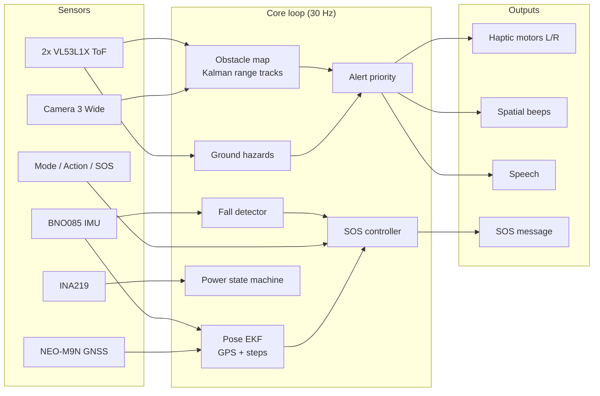

# NavSight 🧭

[](https://github.com/robofan45/Newnavsight/actions/workflows/ci.yml)
[](https://python.org)
[](https://raspberrypi.com)
[](LICENSE)

NavSight is a multi-sensor smart cane for people with blindness or low vision, built on a
Raspberry Pi 5. **Version 2** fuses two time-of-flight distance sensors, a 9-axis IMU, a wide
camera and multi-constellation GPS, and turns what it senses into vibration, directional sound
and speech, in that order of priority.

## What's new in v2

| | v1 | v2 |
|---|---|---|
| Distance | 1× HC-SR04 ultrasonic | 2× VL53L1X ToF: one forward, one aimed down |
| Ground hazards | not detected | drop-offs (stairs, curbs, potholes) and step-ups |
| Motion | none | BNO085 IMU: heading, steps, fall detection |
| Indoors | GPS only (fails indoors) | IMU step dead reckoning when GPS drops out |
| Camera | Pi Camera 3 (66°) | Pi Camera 3 Wide, YOLOv8n plus optional MiDaS depth |
| GPS | NEO-8M | NEO-M9N (GPS + GLONASS + Galileo + BeiDou) |
| Fusion | none | EKF pose plus Kalman-tracked obstacles with time to collision |
| Alerts | audio only | haptic > spatial audio > speech, with cooldowns |
| Emergency | none | SOS button and automatic SOS after a fall, with a cancel countdown |
| Battery | dies without warning | INA219 charge estimate, low-battery warnings, power modes |

## How it works



- **Obstacles**: the forward ToF and camera detections share a sector map across the camera's
  view. Each sector runs a Kalman filter on range, so NavSight knows how fast something is
  approaching and warns earlier when a collision is close.
- **Ground**: the down ToF learns the normal distance to the ground and flags a sudden increase
  (a drop) or decrease (a step up), corrected for the cane's tilt.
- **Position**: an extended Kalman filter combines GPS with IMU steps and heading, so position
  keeps updating indoors.
- **Alerts**: vibration first (instant, left or right by direction, stronger when closer), then
  beeps panned left or right, then short spoken descriptions such as "person slightly left,
  2 meters." Cooldowns and hysteresis keep it from talking constantly.
- **Falls**: a hard impact followed by the cane lying still and flat starts a 15-second countdown.
  Any button cancels it; otherwise an SOS with your location is sent.
- **Power**: below 20 % battery, or after 2 minutes idle, NavSight lowers the camera rate, turns
  off depth and duty-cycles the GPS; after 10 minutes idle it sleeps until the cane moves.
  Obstacle sensing stays on whenever the cane is moving.

[docs/ARCHITECTURE.md](docs/ARCHITECTURE.md) describes every module and its exact behaviour.

## Try it without hardware

The simulator runs the full software on any PC with a scripted walk: a pole getting closer, a
person on the left, a curb, losing GPS indoors, a draining battery and a fall.

```bash
pip install -r requirements-dev.txt
python -m navsight --sim            # real time, about 70 seconds
python -m navsight --sim --speed 0  # as fast as possible
```

It prints what the cane would do: vibration levels, beeps and every spoken message.

## Install on the Raspberry Pi 5

See [docs/HARDWARE.md](docs/HARDWARE.md) for the wiring, `config.txt` settings and calibration.
In short:

```bash
sudo apt install -y python3-venv python3-picamera2 python3-lgpio espeak-ng libportaudio2 i2c-tools
git clone https://github.com/robofan45/Newnavsight.git && cd Newnavsight
python3 -m venv --system-site-packages .venv
.venv/bin/pip install -r requirements.txt && .venv/bin/pip install -e .
.venv/bin/navsight --battery-full     # after charging the power bank
.venv/bin/navsight                    # start
```

## Controls

| Button | Short press | Long press |
|---|---|---|
| **Mode** (GPIO 17) | cycle alerts: full, brief, vibration only | camera on or off |
| **Action** (GPIO 22) | what is ahead and which way you are facing | battery, GPS and mode report |
| **SOS** (GPIO 27) | reminder: "Hold for two seconds to send SOS" | send SOS (hold 2 s) |

Any button cancels a fall countdown.

| Vibration | Meaning |
|---|---|
| steady, left or right motor | obstacle on that side; stronger = closer |
| both motors | obstacle straight ahead |
| 3 strong pulses | drop ahead (stairs, curb, hole) |
| 2 medium pulses | step up ahead |
| 2 slow pulses | battery low |

## Configuration

Every setting has a default that matches the V2 design. Override only what you need in a JSON
file and pass it with `--config`:

```json
{
  "alerts": {"verbosity": "brief"},
  "imu": {"forward_axis": "y", "heading_offset_deg": 2.0},
  "sos": {"telegram_bot_token": "...", "telegram_chat_id": "..."}
}
```

`navsight --print-config` shows every setting. Unknown keys are rejected, so typos are caught.

### SOS contacts

NavSight always writes SOS events to `~/.navsight/sos.log`. To alert someone, set either:

- `sos.telegram_bot_token` and `sos.telegram_chat_id`: a Telegram bot that messages a family
  member (create one with @BotFather), or
- `sos.webhook_url`: any HTTPS endpoint that accepts a JSON POST (for example an automation
  service that sends an SMS).

The message includes a Google Maps link to your last known position and the battery level.
Failed sends are retried after 5, 15, 30 and 60 seconds. The Pi needs a network connection
(Wi-Fi or a phone hotspot) for remote alerts.

## Development

```bash
pip install -r requirements-dev.txt
python -m pytest          # unit and simulator integration tests, no hardware needed
ruff check navsight tests && ruff format --check navsight tests
```

```
navsight/        the v2 package (hardware/, perception/, fusion/, alerts/, power/, safety/)
tests/           pytest suite
docs/            ARCHITECTURE.md (software), HARDWARE.md (wiring and setup)
config/          example settings file
systemd/         service file to start NavSight on boot
v1/              the original v1 scripts for the HC-SR04 hardware
```

## Safety note

NavSight is a research prototype that adds information on top of a long cane; it does not
replace the cane, a guide dog or orientation and mobility training. Test it in a safe place
first, and keep the normal cane technique.

## License

MIT, see [LICENSE](LICENSE).
